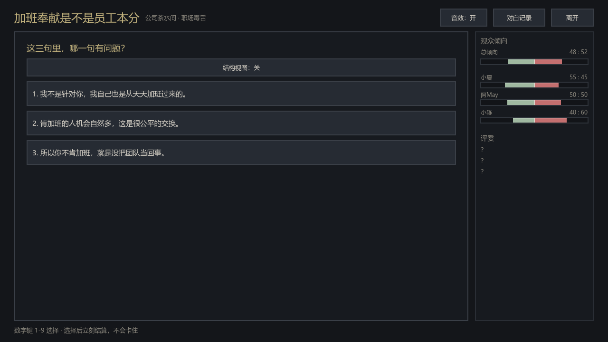
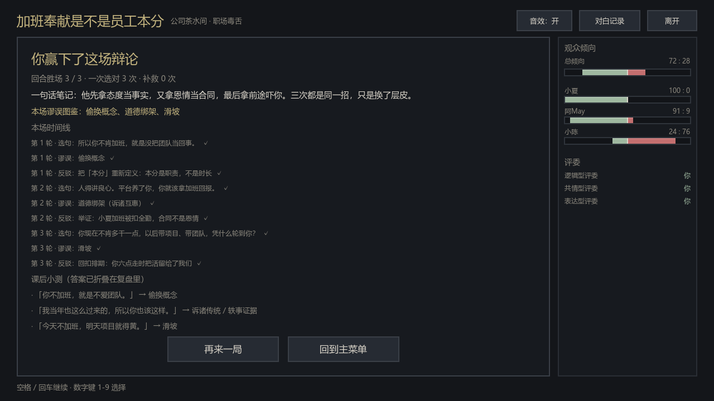

# 《诡辩之术》 The Art of Sophistry

[](https://github.com/1466034859-rgb/the-art-of-sophistry/actions/workflows/tests.yml)
[](LICENSE)

像素风 · 回合制 · 1v1 嘴炮卡牌对战。
Godot 4.7（GL Compatibility 渲染器），全部逻辑与 UI 均以 GDScript 实现，卡池 / 角色 / 场景 / 状态全部数据驱动。

> 本工程按《诡辩之术 项目全量交接文档 v1.0》从零落地，并补完了文档中的四个 To-do：
> AI 对战、视觉润色、卡池扩充、情景系统。当前是**四场故事可玩**的成品试玩版：
> 茶水间·加班、评论区·帮扶门槛、年夜饭·快乐/成绩、咖啡馆·科学/情感。

**GitHub 仓库：** https://github.com/1466034859-rgb/the-art-of-sophistry

<table>
<tr>
<td></td>
<td></td>
</tr>
</table>

---

## 0. 快速开玩

| 方式 | 操作 | 说明 |
| --- | --- | --- |
| 下载试玩包（推荐） | 到 [Releases](https://github.com/1466034859-rgb/the-art-of-sophistry/releases) 下载 `Sophistry-playtest.zip`，解压后双击 `run_game.bat` | 需要本机装有 Godot 4.7；脚本会找到常见安装路径，找不到会提示 |
| 编辑器 | 用 Godot 4.7 打开 `project.godot`，按 F5 | 最稳，适合改内容 |
| 导出 exe | `powershell -File tools\build_windows.ps1` | 需要先在 Godot 里安装 4.7 export templates（本机证书链异常，无法由脚本自动下载）；产物在 `build\Sophistry.exe` |

进游戏后：主菜单 →「故事模式 · 四场辩论」→ 选一场 → 空格/回车继续、数字键 1-9 选择。
顶栏可开关音效、打开「对白记录」回看台词；按 `Esc` 暂停，按 `F3` 看调试信息。
遇到问题点「反馈」，会把日志/截图打包到本地文件夹，发到
[Issues](https://github.com/1466034859-rgb/the-art-of-sophistry/issues) 即可。

---

## 1. 运行

- 编辑器打开：用 Godot 4.7 打开本目录（`project.godot`），F5 运行；或双击 `run_game.bat`。
- 操作系统：游戏内不需要任何外部素材，中文字体通过 `SystemFont` 调用系统字体
  （微软雅黑 / Noto Sans CJK 等），因此换机器不会出现豆腐块；音效由 `ui/sfx.gd` 在运行时合成，同样不依赖外部音频文件。
- 窗口：1280×720，可缩放（`canvas_items` 拉伸）。

命令行验证（无需打开编辑器）：

```powershell
# 纯逻辑：数据完整性 + 机制断言 + 128 局 AI 对局 + 60 张卡逐张覆盖
powershell -File tools\dev.ps1 test

# 故事模式：数据校验 + 正确/全错/补救/隐忍四条路径 + 200 局随机乱点（防死路）
powershell -File tools\dev.ps1 story

# 故事 UI 全链路：四场都从场景卡点到复盘（真实按钮回调）
powershell -File tools\dev.ps1 story-ui

# 错误分支 UI 回归：全错路径，任何选择页必须至少 2 个选项（防“选错后没选项”）
powershell -File tools\dev.ps1 story-wrong

# 生成故事模式关键节点截图（需要真实渲染）
powershell -File tools\dev.ps1 capture-story

# UI：脚本代打整局，验证 主菜单→选人→战斗→结算 全链路
powershell -File tools\dev.ps1 ui

# 启动主场景 120 帧，检查启动报错
powershell -File tools\dev.ps1 boot

# 重新生成 screenshots/*.png（需要真实渲染，不要加 --headless）
powershell -File tools\dev.ps1 capture

# 一次跑完 import + test + ui + boot
powershell -File tools\dev.ps1 all
```

> `tools/dev.ps1` 里的 `$Godot` 默认指向本机路径，换机器时改成自己的 Godot 可执行文件即可。
> 若工程目录下存在 `.appdata` 文件夹，脚本会把它当作 `APPDATA`（headless 沙箱下重定向 `user://` 用）。

当前实测：卡牌逻辑 `checks=1402 failures=0`，故事模式 `checks=892 failures=0`（四场，含 200 局随机乱点），
四场 UI 全链路 `checks=22`、错误分支 UI `checks=48`、反馈/日志自检 `checks=14`、程序化音效自检 `checks=9`，UI 冒烟 `RESULT PASS`，启动无脚本错误。

---

## 2. 目录结构

```
project.godot          工程配置（Autoload: GameData；主场景 scenes/main.tscn）
icon.svg               图标（手写 SVG 像素嘴炮气泡）

autoload/game_data.gd  启动时加载 data/*.json，供 UI 取角色 / 场景列表
core/                  纯逻辑层（无 UI 依赖，可 headless 实例化）
  logic_card.gd        LogicCard：类型 / 标签 / 费用 / 伤害 / 效果操作
  character_resource.gd 角色：标签倾向、专属被动、AI 性格权重、专属卡组
  scenario_resource.gd  情景：环境修正因子
  status_def.gd        状态定义（Buff/Debuff 的数值修正字典）
  debate_topic.gd      辩题：命题 / 立场 / 3 个争点 / 素材库 / 复盘
  game_library.gd      数据加载 + 克制矩阵 + 数据自检（不依赖 Autoload）
  battle_engine.gd     战斗内核：状态机 / 响应结算 / 伤害公式 / 被动 / 状态 / 效果解释器 / 争点判定
  story_engine.gd      故事模式内核：场景卡 / 序幕 / 找漏洞 / 补救 / 观众倾向 / 评委投票 / 复盘
ai/ai_controller.gd    AI 大脑：响应决策 + 性格权重出牌 + 压力检测 + 争点偏好
ui/                    表现层（全部代码构建，无 .tscn 拼装）
  main.gd              主控：主菜单 / 角色·对手·场景选择 / 场景切换
  battle_screen.gd     战斗屏：辩题条、出牌、响应倒计时、对白、战报、结算 + 复盘
  story_screen.gd      故事屏：场景卡、逐句对白、找漏洞选择、观众跑票、评委投票、复盘
  tug_bar.gd           观众倾向条（中分双半：左倾你 / 右倾对方 + 总倾向）
  sfx.gd               程序化音效（运行时合成 PCM，无外部音频素材）
  card_widget.gd       手牌控件（像素卡面、悬浮放大、可用性置灰）
  spirit_bar.gd        心气条（分段像素块 + Tween 平滑过渡 + 受击闪烁）
  battle_juice.gd      打字机 / 震屏 / 浮动伤害数字 / 淡入
  ui_kit.gd            调色板 + Theme + 控件工厂
data/                  纯数据（改这里即可平衡 / 加内容）
  cards.json           60 张卡（4 角色 × 15）+ 手法 / 谬误 / 台词模板
  characters.json      4 名角色 + 被动 + AI 权重
  scenarios.json       4 个场景 + 环境修正
  statuses.json        状态库
  topics.json          辩题（当前 1 个完整样板：年夜饭·被追问工资）
  stories.json         故事模式脚本（4 场完整可玩：茶水间 / 评论区 / 年夜饭 / 咖啡馆）
scenes/main.tscn       仅一个挂 main.gd 的根 Control
tests/                 headless 测试与自动截图
screenshots/           自动截图产物（菜单 / 选人 / 战斗 / 故事关键节点 / 结算）
docs/                  调研底稿、自主推进计划、QA 报告
run_game.bat           双击启动（需本机装有 Godot 4.7）
export_presets.cfg     Windows Desktop 导出预设
tools/dev.ps1          构建 / 测试辅助脚本
tools/build_windows.ps1 导出 Windows exe（需先安装 4.7 export templates）
tools/qa_stats.py      四场阅读量 / 预计时长统计
tools/apply_card_flavor.py  批量维护 60 张卡的手法 / 谬误 / 台词模板（幂等）
```

---

## 3. 已实现内容（对照交接文档）

| 交接文档 | 状态 | 落点 |
| --- | --- | --- |
| 核心资源类（LogicCard / CharacterResource） | ✅ | `core/logic_card.gd`、`core/character_resource.gd` |
| BattleManager 状态机 + 响应窗口 | ✅ | `core/battle_engine.gd`（`AWAITING_ACTION / WAITING_FOR_RESPONSE / SETTLING / ENDED`） |
| 标签克制矩阵（FACT→EMOTION→VALUE→LOGIC→FACT，×2.0） | ✅ | `GameLibrary.fit_matrix`，含单测 |
| 角色选择 → 战斗场景切换 | ✅ | `ui/main.gd` → `ui/battle_screen.gd` |
| 四大角色专属卡组与效果 | ✅ | `data/cards.json`（每人 15 张，共 60 张） |
| 心气条 / 对话框 / 手牌区 UI 链路 | ✅ | `ui/` 全部，signal 驱动 |
| **To-do：AI 对战** | ✅ | `ai/ai_controller.gd`，响应决策 + 性格权重 + 低心气抢诡辩 |
| **To-do：视觉润色** | ✅ | 打字机对白、心气条 Tween、受击闪烁、屏幕震动、浮动伤害数字、响应倒计时 |
| **To-do：卡池扩充到 20 张/角色** | ⚠️ 15 张/角色 | 文档两个段落口径不一致；已按"15 张 × 4 = 60 张"的完整表格落地，扩到 20 张只需继续加 JSON |
| **To-do：情景系统** | ✅ | `data/scenarios.json` + 伤害倍率 / 拆解回血 / 诡辩自损减免 |
| **文案连接层：辩题 / 争点 / 台词模板 / 复盘** | ✅ 样板 | `data/topics.json` + `core/debate_topic.gd` + 卡牌 `target`/`reply` 模板 |
| **故事模式：五段式剧情 + 找漏洞 + 观众/评委** | ✅ 四场可玩 | `data/stories.json` + `core/story_engine.gd` + `ui/story_screen.gd` |
| 箱庭探索 / 认知碎片 / 言证饭堂升级 | ⏳ 未做 | 本轮范围锁定"完整可玩纵切"，见 roadmap |

---

## 4. 规则实现（以代码为准）

### 4.1 一回合的流程

1. **回合开始**：AP 重置为 2（受 `ap_delta` 状态修正）；抽 1 张牌；结算 DOT / 回血状态。
2. **出牌阶段**（`AWAITING_ACTION`）：出一张手牌（消耗卡面 AP，诡辩卡通常 2 AP），或"沉默"让出话头。
3. **响应窗口**（`WAITING_FOR_RESPONSE`）：对方有 3 秒（受场景 / 状态修正）决定怎么接。
4. **结算**（`SETTLING`）：按下面的四种结果结算伤害 / 效果，然后切换回合（或触发额外回合）。

### 4.2 响应窗口的四种结果

| 结果 | 触发条件 | 结算 |
| --- | --- | --- |
| **完全拆解 PERFECT** | 用**标签克制**攻击卡的【拆解卡】 | 伤害全免，按 `×2 克制` 反打，并执行该卡的 `counter_effects` |
| **勉强拆解 PARTIAL** | 用**不克制**的【拆解卡】 | 只吃一半伤害，反打一半，`counter_effects` 照常生效 |
| **诡辩对拼 TRADE** | 用【诡辩卡】硬接 | 自己吃 70% 伤害，同时把诡辩卡的伤害打回去（"温和陷阱"会把这份伤害减半），双方都吃自损 |
| **哑口无言 SILENCE** | 窗口内没出牌 / 放弃 | 吃满伤害 + 破防惩罚（事实狂魔的事实卡惩罚 ×1.5），并附上【破防】 |

> 【构建卡】不能用于响应；响应也有 AP 成本，所以"留 AP 防守"是真实取舍。

### 4.3 伤害公式

```
Final = (Base × Fit × CharBonus + Flat) × OutMult × ScenarioMult
```

- `Fit`：克制 ×2.0，否则 ×1.0。**主动攻击**看"卡的标签 vs 对手角色倾向标签"；**拆解反击**看"拆解卡标签 vs 攻击卡标签"。
- `CharBonus`：卡牌标签与本角色倾向一致时 ×1.2。
- `Flat / OutMult`：来自状态（蓄势、动摇、共鸣……）与场景修正。
- 目标的 `incoming_damage_mult` 在真正扣心气时再乘一次。
- **单次心气损失上限 4**（防止"克制 × 角色加成 × 状态"叠出满血秒杀）；`execute` 类终结技走独立判定。

### 4.4 心气与胜负

- 双方初始 5 点心气，归零即"破防"落败。
- 回合上限 60；超时比心气高者胜，相同则平局。
- 无牌可抽时每次尝试抽牌扣 1 点（"思路枯竭"）。

### 4.5 角色被动（真实生效）

| 角色 | 被动 | 实现 |
| --- | --- | --- |
| 温和的杀手 | 礼貌陷阱 | 对方用诡辩卡硬接自己的构建卡时，诡辩伤害减半 |
| 事实狂魔 | 证据压制 | 事实卡造成"哑口无言"时，沉默惩罚 ×1.5 |
| 共情怪 | 道德高地 | 对方拆解未完全抵消（PARTIAL）时，对方额外 -1 心气 |
| 杠精之王 | 反向快感 | 自己被打出 PERFECT 时回复 1 点心气 |

### 4.6 场景修正

| 场景 | 环境倾向 | 效果 |
| --- | --- | --- |
| 家庭年夜饭 | 情绪 | 情绪伤害 ×1.25，事实伤害 ×0.85 |
| 公司茶水间 | 逻辑 | 逻辑伤害 ×1.15，情绪伤害 ×0.9 |
| 深夜评论区 | 情绪 | 情绪 ×1.2、事实 ×0.8，诡辩自损 ×0.8 |
| 学术咖啡馆 | 逻辑 | 逻辑伤害 ×1.2，逻辑拆解成功额外回 1 心气 |

### 4.7 辩题层（文案为什么能接住上一句）

一场对战如果有绑定辩题，会多出一层「辩论」结构，让卡牌从孤立独白变成一场有命题的吵架：

1. **辩题**：一个具体命题 + 双方立场 + 利害（输了会怎样）。开场白把玩家拉进场景。
2. **3 个争点**：按顺序推进。每个争点有文本、标签（对方话术的性质）、素材库（可引用的细节）。
3. **台词模板**：每张卡的 `target` / `reply` 模板会把 `{claim}`、`{material}`、`{last_move}`
   等变量替换成当前局势，所以同一张「数据摊牌」在「问工资是关心」和「一家人不该有秘密」
   两个争点下说的是两套完全不同、但都接得上上下文的话。
4. **论点判定**：每次交换比「论点压力 = 本回合造成的伤害 + 标签对题加成(+2)」；
   压力高者赢下该争点，得 1 论点分；平手时由标签克制关系裁决；僵持 4 次则判该争点无效。
   **先拿 2 个争点者赢下整场辩论**（心气归零仍然是直接破防，两套胜负条件并存）。
5. **复盘**：战后统计本局用过的招法、踩到的谬误（含一句人话解释）、赢下/丢掉的争点与教训。

> 为什么不是"每个卡 × 每个辩题"写死台词：60 张卡 × N 个辩题会爆炸。模板变量把
> 「卡的性格（怎么说）」和「辩题的事实（在说什么）」解耦，加新辩题只需要写
> `topics.json`（3 个争点 + 素材），不需要重写 60 张卡。

当前样本：**家庭年夜饭 · 过年被追问工资**（暖场毒舌），三争点分别是
「问工资是关心，不是冒犯」（情绪包装）→「一家人不该有秘密」（价值绑架）→
「你不说，就是混得不好」（伪事实推定）。另外 3 个场景尚未绑定辩题，会退化为纯卡牌对战。

### 4.8 故事模式（v0.2，叙事 + 找漏洞 + 观众/评委）

`data/stories.json` + `core/story_engine.gd` + `ui/story_screen.gd` 组成的「一场完整辩论」：

1. **五段式**：场景卡 → 序幕日常对白 → 分歧触发 → 三回合交锋 → 结辩 → 评委投票 → 尾声 → 复盘。
2. **动作 B（核心玩法）**：每回合先读对方 3 句陈词，**第一步 3 选 1 选出有问题的句子**，
   **第二步 3~4 选 1 命名谬误**；选错 → 对方反问 + 观众跑票 + **一次补救**（提示 + 去掉一个错误项）；
   补救失败 → 兜底分支，回合判对方。
3. **观众倾向 + 评委三票**：三组观众（支持 / 中立 / 反对）实时跑票；
   三位评委按「逻辑 / 共情 / 表达」的规则投票，2 票以上获胜。
4. **零死路保证**：`StoryEngine` 的每个选项都绑定出口；`GameLibrary` 在加载期校验
   每个错误选项必须有 `wrong_reply`、每回合恰好 1 个漏洞句、必须有兜底分支；
   `tests/test_story.gd` 用 **4 场 × 40 局随机乱点**验证任何选项都能推进流程、最终抵达复盘。
5. **当前样本**：四场全部可玩——茶水间·加班是不是本分、评论区·帮扶门槛、
   年夜饭·快乐/成绩、咖啡馆·科学/情感。主菜单「故事模式」进入选择界面。
6. **交互细节（v0.3）**：空格/回车继续、数字键 1-9 选择；「结构视图」开关会显示每句的
   论证结构（漏洞句显示为「结论」，不剧透）；评委逐票揭晓；复盘新增「本场时间线」，
   逐轮记录你选了哪句、命名成什么、对错；Esc 暂停（继续 / 重开 / 离开）；标题使用硬描边 + 投影的像素感样式。

---

## 5. 数据格式（改 JSON 就能做内容）

### 5.1 `data/cards.json`

```json
{
  "id": "pa01",                     // 唯一 id
  "owner": "polite_assassin",       // 所属角色 = 进入谁的卡组
  "name": "礼貌认同",
  "type": "CONSTRUCTION",           // CONSTRUCTION / DECONSTRUCTION / PIVOT
  "tag": "VALUE",                   // FACT / EMOTION / VALUE / LOGIC
  "cost": 1,                        // 缺省 1；诡辩卡通常 2
  "damage": 1,                      // 缺省 0；基础伤害（上限建议 ≤2，见平衡说明）
  "silence_penalty": 0,             // 对方沉默时额外伤害，缺省 0
  "self_damage": 0,                 // 打出时自身损失
  "dialogue": "……",                 // 对白（无模板时的兜底）
  "effects": [ ... ],               // 主动打出时执行
  "counter_effects": [ ... ],       // 成功拆解/对拼时执行
  "move": {                         // 这张牌在辩论里是什么「手法」
    "name": "举证",                 // 显示在台词旁、复盘统计里
    "fallacy": "",                  // 踩到的谬误（空 = 不是谬误）
    "lesson": ""                    // 复盘时对这条谬误的一句人话解释
  },
  "target": "……{claim}……",          // 主动打出时的台词模板
  "reply": "……{last_move}……"        // 作为回应打出时的台词模板（拆解/诡辩卡）
}
```

台词模板变量：`{claim}` 当前争点、`{material}` 当前争点素材随机一条、`{topic}` 辩题标题、
`{last_move}` 对手上一手的手法名、`{last_card}` 对手上一张卡、`{npc}` 对手角色名。
缺省 `target`/`reply` 时回退到 `dialogue`。

支持的效果操作（`effects` / `counter_effects` 通用，`target` 取 `self` / `enemy`）：

| op | 参数 | 说明 |
| --- | --- | --- |
| `damage` | `amount` | 直接伤害（吃目标受伤加成） |
| `heal` | `amount` | 回复心气（默认 self） |
| `lose_spirit` | `amount` | 直接扣心气（不吃加成，用于"反噬"） |
| `status` | `id`, `dur?` | 挂状态 |
| `clear_status` | `kind: buff/debuff/all` | 清状态 |
| `draw` / `discard` | `amount` / `count` | 抽牌 / 随机弃牌 |
| `ap` | `amount` | 下回合 AP 修正 |
| `extra_turn` | — | 获得额外回合 |
| `shuffle` | — | 把对方手牌洗回牌库再抽同样张数 |
| `reflect_damage` | `mult`, `min` | 按最近一次受伤值反弹 |
| `execute` | `mode: leading/enemy_below/chance_win` | 终结技判定 |
| `random` | `options: [[op...], [op...]]` | 随机执行一组 |
| `if` | `cond`, `then`, `else` | 条件分支 |
| `log` | `text` | 只写战报，无数值效果 |

条件 `cond`：`self_spirit_lte`、`enemy_spirit_lte`、`self_leading`、`self_behind`、
`enemy_has_status`、`self_has_status`、`enemy_hand_has_tag`、`enemy_lost_spirit`、`outcome`。

### 5.2 `data/statuses.json`

```json
"st_shaken": { "name": "动摇", "kind": "debuff", "desc": "…", "duration": 1,
               "mods": { "outgoing_damage_flat": -1 } }
```

支持的 `mods` 键：`outgoing_damage_flat`、`outgoing_damage_mult`、`incoming_damage_mult`、
`counter_damage_flat`、`dot`、`heal_per_turn`、`ap_delta`、`ap_cost_delta`、
`response_time_delta`、`silence_penalty_mult`、`enemy_response_chance_delta`、
`on_attack_self_damage_chance`、`on_attack_self_damage`、`ban_type`、`ban_response`。

### 5.3 `data/topics.json`（辩题）

```json
{
  "id": "new_year_salary",
  "scene": "new_year_dinner",          // 绑定场景；有辩题的场景才会进入辩论层
  "title": "过年被追问工资",
  "proposition": "亲戚有没有资格过问你的收入",
  "your_side": "隐私边界：你可以选择不答",
  "npc_side": "关心伦理：问你是把你当自家人",
  "stake": "答错一句，接下来一整晚，你都是饭桌上的公共案例。",
  "opening": { "npc": "「哟，工作一年了吧？……」", "player": "……" },
  "claims": [
    {
      "text": "问工资是关心，不是冒犯",
      "tag": "EMOTION",                // 对方话术的性质 → 决定「对题手法」
      "npc_lines": ["我把你当自家人", "我这是为你好"],
      "material": ["表姐去年被问完工资，今年没回来过年"],
      "lesson": "把「关心」和「越界」混成一件事，是偷换概念。"
    }
  ],
  "debrief": {
    "win": "你把这顿饭的话头拿了回来。",
    "lose": "全桌都记住了你的数字。",
    "draw": "谁也没赢，但没人再问。",
    "lessons": ["用事实接情绪，用反问接价值。"]
  }
}
```

- `tag` 是**对方话术的性质**；克制它的标签就是「对题手法」（克制关系自动推导：
  FACT→EMOTION→VALUE→LOGIC→FACT），对题出手额外 +2 论点压力。
- 每个争点必须给 3–4 条 `material`，否则台词模板里的 `{material}` 会为空。
- 加一个新辩题 = 复制一份、改场景/争点/素材 + 在 `scenarios.json` 里保留对应场景 id，**不需要改代码**。
  没有 `topics.json` 条目的场景会退化为纯卡牌对战。

### 5.4 `data/stories.json`（故事模式）

```json
{
  "id": "pantry_overtime",
  "scene_id": "office_pantry",
  "title": "加班奉献是不是员工本分",
  "scene_card": { "time": "…", "place": "…", "present": "…", "reason": "…", "stake": "…" },
  "prologue": [ { "speaker": "小夏", "text": "…", "evidence": "A" } ],
  "trigger": { "line": "…", "question": "你要怎么做？",
               "options": [ { "id": "endure", "text": "忍" }, { "id": "speak", "text": "开口" } ] },
  "endure": { "audience": { "support": -18 }, "lines": [ … ], "debrief_note": "…" },
  "topic": { "proposition": "…", "your_side": "…", "npc_side": "…",
             "audience_init": { "support": 55, "neutral": 50, "oppose": 40 } },
  "rounds": [{
    "statements": [ { "text": "…", "structure": "背景", "flaw": false }, … ],  // 必须恰好 1 句 flaw=true
    "question": { "options": [
      { "text": "偷换概念", "correct": true },
      { "text": "以偏概全", "correct": false, "wrong_reply": "…",
        "audience": { "support": -4 }, "remedy_hint": "…" } ] },
    "correct": { "reply": "…", "audience": { … }, "judge_note": "偷换概念" },
    "rebuttal": { "options": [ { "text": "…", "correct": true, "result": "…" }, … ] },
    "remedy": { "hint": "…", "remove": "…" },
    "fallback": { "reply": "…", "audience": { … } }
  }],
  "closing": { "options": [ { "id": "A", "text": "…", "audience": { … } } ] },
  "judges": [ { "name": "逻辑型评委", "rule": { "min_correct_first": 2 } }, … ],  // 必须 3 位
  "epilogue_win": [ … ], "epilogue_lose": [ … ],
  "debrief": { "note": "…", "fallacies": [ … ], "quiz": [ { "q": "…", "a": "…" } ] }
}
```

**校验规则（加载期，不满足会在 `dev.ps1 test/story` 报错）**：
- 每个错误选项必须有 `wrong_reply`（否则就是“点了没反应”）；
- 每回合必须恰好 1 句 `flaw=true`；
- 每回合必须有 `remedy.hint` 与 `fallback`；
- 结辩选项、3 位评委、复盘字段齐全。

**加一场故事**：复制一个对象 → 改 `scene_id` 与文案 → 跑 `dev.ps1 story`，
全路径测试会遍历所有选项确认没有死路，再跑 `dev.ps1 capture-story` 出截图。

### 5.5 加内容

- **加卡**：往 `cards.json` 追加对象，`owner` 指向已有角色 id，`status` 只引用 `statuses.json` 里已有的 id。
  数据校验（`GameLibrary.missing_status_references()`）会在 `dev.ps1 test` 里报错。
  手法 / 谬误 / 台词模板建议通过 `tools/apply_card_flavor.py` 维护（幂等，改文案后重跑即可）。
- **加角色**：在 `characters.json` 加一项（`affinity` / `passive` / `ai.counter_rate` / `ai.weights`），
  再给这个 id 写 15 张卡；被动是 `passive` 字符串，需要时在 `battle_engine.gd` 的
  `_apply_passives()` / `_silence_penalty()` 等处加分支。
- **加场景**：往 `scenarios.json` 加一项，`mods` 支持 `damage_by_tag`、`counter_heal_by_tag`、
  `pivot_self_damage_mult`、`response_time_delta`、`spirit_start`。
- **加辩题**：往 `topics.json` 加一项并绑定场景（见 5.3），无需改代码。

---

## 6. 数值平衡（实测）

- 128 局 AI 自对弈（4×4 角色 × 8 种子 × 4 场景轮换，其中年夜饭场景会进入辩题层）：
  **先手 73 胜 / 后手 55 胜**（≈57%），无平局，最长 7 回合，最多 28 个决策步。
  后手补偿：AI 起手多 1 张牌、首回合多 1 点 AP。
- 辩题层：争点压力 = 伤害 + 对题加成（+2）；先拿 2 个争点即赢，防止"无限对喷"。
- 单次伤害上限 4，因此任何一击都不能从满血直接终结对局（终结技除外）。
- 基础伤害整体压在 1–2 区间，爆发来自"克制 ×2 + 状态 + 沉默惩罚"，而不是裸数值。

调平衡时优先改 `data/cards.json` 的 `damage` / 状态数值 / `topics.json` 的争点数量，再跑
`dev.ps1 test` 看胜率与回合数。

---

## 7. 与设计文档的差异（刻意取舍，已落地验证）

1. **AP 落地为"每回合 2 点"**：文档只出现"AP 消耗"字样没定义数值，这里定义 2 AP/回合，
   出牌与响应共用，形成"进攻 or 留防"的取舍。
2. **诡辩卡可作为响应 = 对拼（TRADE）**：文档中"温和陷阱"要求对方在响应窗口打诡辩卡，
   因此响应不只有拆解卡；对拼双方都受伤，且受"礼貌陷阱"减半。
3. **沉默惩罚默认 0**：文档的"破防 + 全额伤害"由卡面伤害本身承担；只有事实狂魔的关键事实卡
   显式带 `silence_penalty`，让"证据压制"被动有存在感。
4. **单次伤害上限 4 / 基础伤害 ≤2**：纯为可玩性加的保护，否则 5 点心气下"克制 + 角色加成"一击满血秒。
5. **部分卡牌的"概率 / 换牌 / 标记"效果做了机制等价改写**（例如"话题漂移"改为清 Buff + 洗对方手牌，
   "逻辑跳跃"改为随机伤害或回血），文案全部保留。
6. **暂无音频、暂未使用像素位图素材**：视觉用调色板 + 直角 + 2px 描边模拟像素感，
   字体走系统 CJK 字体，避免仓库里塞大字体文件。
7. **辩题层是新增的元结构（文档未提及）**：文档只有"卡牌 + 标签"，缺一个"在争什么"的锚点。
   本轮补了辩题 / 争点 / 台词模板 / 复盘四件套，当前只有年夜饭一场完整样板，其余场景待写。
8. **争点判定用"压力"而非纯标签**：纯标签克制会导致某些角色整副牌组都没有对题标签、
   永远赢不了争点；因此改成本回合伤害 + 对题加成比大小，保证人人可争、选对标签仍是明显优势。

---

## 8. Roadmap（下一轮建议）

1. **故事 UI/UX 打磨（下一轮）**：结构视图开关、快捷键（空格继续 / 数字键选择）、错误回看、
   评委逐票揭晓、跑票动效；四场逐句去 AI 味。
2. **故事内容扩展**：四场已可玩；后续可加第 5 场与「抓矛盾」机制，让文本历史进入策略。
3. **抓矛盾机制**：记录双方每张牌的立场倾向，前后矛盾时对手可获得「抓住矛盾」重击——
   让"文本历史"真正参与策略（当前复盘里只提醒，未做机制）。
4. **复盘升级**：把复盘做成"本局时间线 + 关键失误提示"，可回看每一手的选择。
5. **表现**：卡牌出手飞行动画、命中火花、破防镜头拉近、像素字体（如 Zpix）替换系统字体。
6. **音频**：打字机音、震动低频、不同标签的命中音效。
7. **箱庭**：WorldMap 探索 → NPC 遭遇 → 难度选择 → 战斗 → 认知碎片 → 卡组升级（言证饭堂）。
8. **存档 / 设置 / 打包**：音量、响应窗口时长、难度；导出 Windows / Web 试玩包。

---

## 9. 交接备忘

- 引擎：Godot **4.7 stable**（GL Compatibility）。脚本大量使用 `class_name` 全局类，
  **新增带 `class_name` 的脚本后需要重新导入一次工程**（`dev.ps1 import` / 打开编辑器），
  否则 headless 脚本会报 "Could not find type"。
- 逻辑层（`core/`、`ai/`）完全不依赖场景树，可以脱离 UI 单测；UI 层只订阅 `BattleEngine` 的 signal。
- **辩题层是可选的**：`BattleEngine.setup_battle(..., topic_id := "")`，不传时按场景自动匹配；
  没有绑定辩题的场景保持原来的纯卡牌对战（现有 128 局回归测试大部分仍走这条路径）。
- 台词模板由 `BattleEngine.render_card_line()` 统一渲染并缓存到 `engine.last_line`，
  UI 只负责显示——不要在 UI 里再渲染一次，否则随机素材会前后不一致。
- **故事模式由 `StoryEngine` 驱动，每个选项都必须有出口**：加载期 `GameLibrary` 会校验
  错误选项是否带 `wrong_reply`、每回合是否恰好 1 个漏洞、是否有兜底分支；
  `tests/test_story.gd` 会随机乱点 200 局确认没有死路。新增剧情后先跑 `dev.ps1 story`。
- `BattleEngine` 的响应窗口**不自己计时**——计时由消费者负责（UI 用 `_process` 倒计时，
  AI 用 `SceneTreeTimer`，测试直接同步调用 `submit_response`），这样逻辑层永远可确定复现。
- 本工程从 `C:\Users\14660\qq-bridge\state\slang-agent\sophistry` 开发并验证，随后整体拷贝到
  `E:\Mind\the-sound`；两边内容一致，后续以目标目录为准。

---

## 10. 交付清单与已知限制

完整的交付物、验收对照表、测试矩阵与已知限制见 [docs/DELIVERY.md](docs/DELIVERY.md)。
速览：

- 开玩：双击 `run_game.bat`，或 Godot 4.7 打开 `project.godot` 按 F5。
- 四场故事：茶水间·加班本分 / 评论区·帮扶门槛 / 年夜饭·快乐成绩 / 咖啡馆·科学情感。
- 测试：`tools/dev.ps1 all`，当前 1402 + 890 + 22 + 9 项全过，UI 冒烟与启动无错误。
- 已知限制：未打包 exe（本机无 export templates 且证书链异常，脚本已就绪）；
  中文像素字体未替换；单场约 4–5 分钟；暂停不存档；无真人试玩数据。

---

## 11. 分发给别人玩 & 收集反馈

详细步骤见 [docs/DISTRIBUTION.md](docs/DISTRIBUTION.md)，速览：

- **打包发给朋友**：`powershell -File tools\make_share_zip.ps1` → 生成 `dist\Sophistry-playtest.zip`；
  对方装 Godot 4.7 后双击 `run_game.bat` 即可玩。
- **想发 exe / Web 版**：在能装 4.7 export templates 的机器上运行 `tools\build_windows.ps1`（或 Godot 导出 Web）。
- **玩家报错/反馈**：游戏内主菜单或故事页点「反馈」→ 写内容 → 保存 → 会生成一个包含
  `feedback.json` / `session.log` / `screenshot.png` 的文件夹，让对方整个发回来即可。
- **自动收集**：`data/distribution.json` 里填 `webhook_url`，保存反馈时自动 POST JSON；填 `feedback_form_url` 会多一个在线问卷按钮。
- **调试**：游戏内按 `F3` 看 FPS / 场景 / 日志路径 / 最近事件。引擎报错由 `FileLogger` 自动写入会话日志。
- **空选项兜底**：即使再遇到异常选项为空，界面会记录日志并给「跳过异常步骤」按钮，保证卡不死。

---

## 12. License

[MIT](LICENSE) © 2026 1466034859-rgb。
